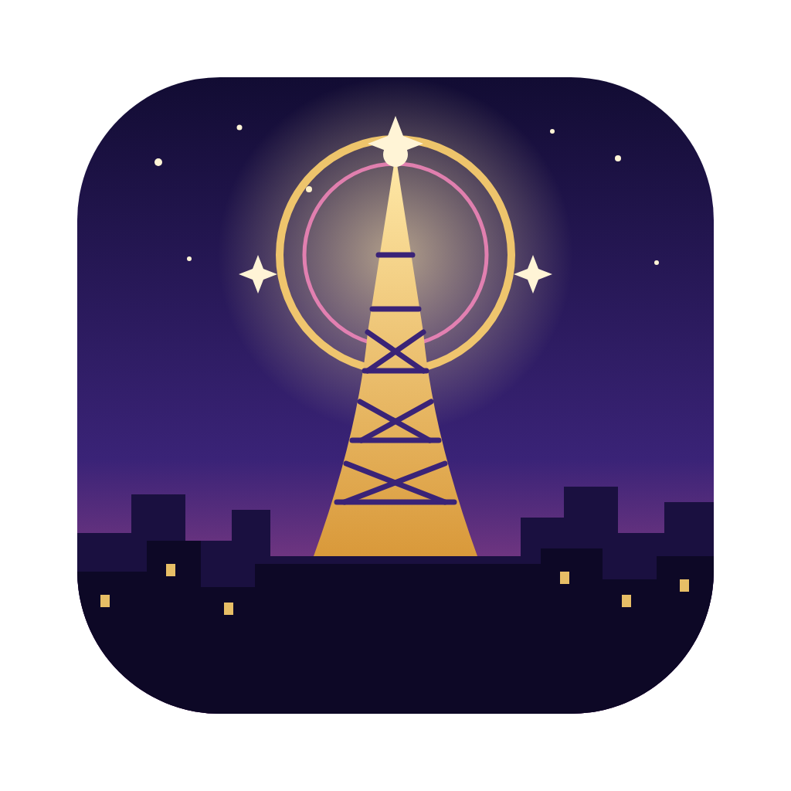
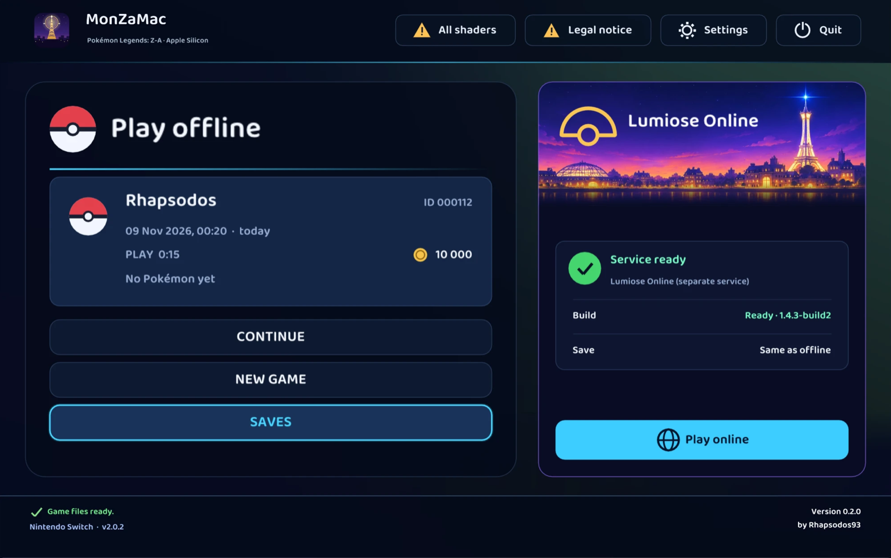

  

<h1 align="center">MonZaMac</h1>

  <strong>Pokémon Legends: Z-A, natively on your Mac</strong> 
  Apple Silicon &middot; Metal &middot; no emulator &middot; optional online play with Lumiose Online

  
  
  

  <a href="#download-and-play">Download</a> &middot;
  <a href="#play-online-with-lumiose-online">Play online</a> &middot;
  <a href="#status">Status</a> &middot;
  <a href="#building-from-source">Build</a> &middot;
  <a href="#get-involved">Contribute</a> &middot;
  <a href="CHANGELOG.md">Changelog</a> &middot;
  <a href="https://github.com/lucabravi/MonZaMac/issues">Issues</a> &middot;
  <a href="https://github.com/Hexveil404/PokeZ-ARecomp">PC port (ZA Recomp)</a>

---

  

Play **Pokémon Legends: Z-A on Apple Silicon**, with Metal graphics, higher internal resolutions, keyboard or
controller input, and a guided setup that prepares your own game files on your Mac. And, if you want, **play it
online** with other trainers through [Lumiose Online](#play-online-with-lumiose-online), a multiplayer mod made by a
separate team.

**Fully open source, under the MIT license, and open to contributions.** Help us improve performance, test on more
Macs, fix bugs or make the documentation better. You do not have to be a developer to [get involved](#get-involved).

## Why play it here

- 🖼️ **Sharper than the Switch.** Render from 25% up to **4× the game's image** (8K in docked mode), let the app pick a
  resolution that holds your frame rate (**Dynamic**), or match your display. **SMAA**, **MetalFX upscaling**,
  anisotropic filtering and sharper textures are one click away, and so are bigger, crisper **shadows**.
- ⚡ **Smooth.** A **60 fps** mode whose world step follows the real frame time, so the game speed stays steady, and
  **smooth distant animation**: characters and Pokémon far from the camera animate every frame instead of in visible steps.
- 🎞️ **Frame generation up to 120 fps** *(optional, experimental)*. MetalFX adds an intermediate frame: **30 real fps are
  shown at 60, and 60 real fps at 120**. It needs macOS 26, a GPU with MetalFX frame interpolation and a 60 or 120 Hz
  screen, and it is off by default. The game keeps its normal speed; fast edges can show artifacts and input does not
  feel like native 120 fps. Details in [docs/frame-generation.md](docs/frame-generation.md).
- 🧩 **Fewer stutters.** **Prepare all shaders** builds the game's shaders once (about five minutes) so scenes and
  battle effects stall far less afterwards, and everything stays in a local cache on your Mac.
- 🎮 **Your controls.** Remappable keyboard and controller input, camera on the mouse or trackpad, and docked or
  handheld mode.
- 🌐 **Online play** *(optional, separate edition)*. **Play online** puts you in the same Lumiose City as every other
  Lumiose Online player: chat, trading, voice chat and more, from the mod's own team. Details
  [below](#play-online-with-lumiose-online).
- 💾 **Your saves.** Named save slots on the start screen, **import and export** as .zip, copies as backups, and
  **Reload this save** from the in-game menu.
- 📦 **A Mac app you can set up yourself.** Download the app, select your game files and let the guided setup build
  everything locally. No development tools needed, and nothing is uploaded.

MonZaMac uses **static recompilation**: the game's ARM64 code is translated ahead of time into C and compiled for
macOS. Its runtime reimplements the Switch operating system services and NVN GPU interface on Metal. No emulator
runs at play time. The supported game version is **v2.0.2 with the Mega Dimension DLC**.

> **Bring your own game.** You need an original copy and game files/keys you are entitled to use. No Nintendo game
> files, code, assets, shaders, keys or fonts are distributed with this project. The open-source license covers
> the project software, not the game or its content.

## Play online with Lumiose Online

**[Lumiose Online](https://lumioseonline.site)** is an unofficial, fan-made multiplayer mod for Pokémon Legends: Z-A,
built and run by its own team: players share Lumiose City, chat, trade and talk (voice chat), on one server for
everyone, on a Switch, in the Eden emulator or on PC, and now on a Mac. **MonZaMac makes it possible to run that
mod natively on a Mac. The mod, the server and the online features are the Lumiose Online team's work; MonZaMac only
runs the mod, and does not operate, control or vouch for the service.** A great thank you to them for making it work
with the Mac port: see [Credits](#credits-and-license).

**Two editions.** The online features are in a separate download so that the standard app stays exactly what it was:

| Edition | Download | What it is |
|---|---|---|
| **MonZaMac** | `MonZaMac-<version>-macOS.dmg` | The standard app: everything offline, nothing ever contacts the online service. |
| **MonZaMac Online** | `MonZaMac-<version>-Online-macOS.dmg` | The same app with a second column on the start screen, **Lumiose Online**, and a **Play online** button. Offline play works as before. |

**How it works.**

1. Install the online edition and set up your game files as usual. Online play needs the game at **version 2.0.2**
   (the one MonZaMac supports) and about **1.3 GB** more disk space, which the app keeps to prepare the mod quickly.
2. Press **Play online**. The first time it tells you what is shared, asks for your consent, then prepares the mod
   **on your Mac**, from your own game files (a few minutes, with a progress bar), and starts the game with it.
3. Every later press checks for a newer version of the mod, downloaded from Lumiose Online's site and checked against
   the hash they publish, and prepares it before starting. Without a connection it starts the version you have.
4. **Quit to start screen** (in the in-game menu, F1) comes back to the start screen without the mod: **Continue** there
   plays offline.

**Your data, your choice.**

- **Online play shares game data with Lumiose Online** while you play (the mod talks to its server at
  `lumioseonline.site`). It is a separate service run by its own team; MonZaMac does not control it or what it does
  with that data. The first press of **Play online** asks you to agree, and the **Legal notice** says it too.
- **Offline play never contacts it.** Nothing is sent unless you press **Play online** and have agreed. The standard
  edition has no **Play online** button and never starts the mod or the network.
- Your **save is the same** online and offline (one slot, one `save_0`). The mod keeps its own settings next to it.
  If you want to be careful, try the online mode with a copy of your save first.
- **Voice chat** uses your Mac's microphone: macOS asks for the permission the first time. The mod decides when to
  capture; its default is push to talk.

**State of this feature.** Online play works end to end on the maintainer's Mac: connecting, seeing other players, the
mod's lists and chat window, and voice chat sending and receiving. It is new: how the voice sounds on other setups, chat messages between Mac and other platforms, play against
Windows or Linux players and every MonZaMac option together with the mod (frame generation, MetalFX temporal,
smooth distant animation) have had less testing, so please report what you find. A mod update that changes how the
mod patches the game needs a small compatibility update on our side before it works here; until then Play online says
it cannot prepare that version and the offline game is unaffected.

For the technical side (what the runtime does for the mod, how a version is prepared, and what is verified) see
[docs/online-lumiose.md](docs/online-lumiose.md). Questions about the mod itself, the server or the community: the
[Lumiose Online site](https://lumioseonline.site) and its Discord.

## Download and play

You need a Mac with Apple Silicon (macOS 15 or later) and **your own copy of the game** (see above).

1. Download `MonZaMac-<version>-macOS.dmg` from the [latest release](https://github.com/lucabravi/MonZaMac/releases/latest)
   (or `MonZaMac-<version>-Online-macOS.dmg` if you want [online play](#play-online-with-lumiose-online)).
2. Open it and drag **MonZaMac** onto **Applications**.
3. Open MonZaMac. The app is not notarized by Apple. If macOS blocks it, use **System Settings > Privacy & Security >
   Open Anyway** after attempting to open it, then confirm the prompt.
4. On the start screen choose **Set up game files** and confirm that you own an original copy. Select your base game
   (**NSP or XCI**), the **v2.0.2 update (NSP)** and your **prod.keys**. The app checks them, applies the update and
   builds the game on your Mac. Allow at least **27 GB of free space**; larger packages may need more, and setup
   checks the requirement before proceeding. The first build takes a while. No game files or keys are uploaded.
5. When it is done, press **Continue** (your most recent save) or **New game**. Your saves and settings are kept in
   `~/Library/Application Support/com.monzamac.app`, and stay there when you update the app.

<strong>Saves</strong>: slots, backups, import and export

 

The start screen shows the save you played last. **Saves** lists them all: pick one (it becomes the one **Continue** plays), start a new one, copy
(a handy backup before trying something), rename, delete, **export** one as a .zip, or **import** a .zip or a folder
with a Z-A save (a JKSV backup, a copy from a console) as a new save. In the game, **F1 > Saves** shows the save you are
playing and the others, and can switch to another one or reload the current one. A save you already had is the first
one in the list, called "Main save" until you rename it.

<strong>Settings and controls</strong>: defaults, keys and the in-game menu

 

A new install starts with fullscreen, a fixed 1080p resolution, 60 fps, SMAA, the original 16:9
picture, anisotropic filtering, and a two-finger trackpad swipe that turns the camera. **1080p is the initial
preset, not the maximum supported resolution.** Choose
higher internal resolutions, Dynamic, Match display or frame generation in **SETTINGS**, available before and during play.

In the game: **F1** opens the menu (video, audio, controls), **F3** shows the frame rate and the render resolution.
Default gameplay controls: WASD move, arrows d-pad, K / J = A / B, Q / E = L / R, Enter / Backspace = Plus / Minus;
the numeric keypad controls the camera. Launcher/menu navigation uses Enter to confirm and Esc to go back.
Bindings can be changed in **SETTINGS > Controls**.

<strong>Shaders</strong>: first-use stutter and how to avoid it

 

Shaders and pipelines compile as needed. A new scene or an update can cause brief first-use stutter; subsequent
visits benefit from the local cache. On the start screen, **All shaders** (in the header) can compile every shader of the
game up front: about five minutes once and about 400 MB of Metal cache, and the first visit to a scene stalls far less.
After some updates the badge turns yellow: run it again.

The **Shaders** tab of the menu can also prepare the ones a catalog knows before the game starts (**Prepare known
shaders**), saves the ones the game had to build as hashes and numbers (**Collect new shader recipes**; nothing is
uploaded) so you can share them by hand with **Export shader recipes** and the **Contribute recipes on GitHub** form,
and fetches the official catalog only when you press **Update shader catalog**. No catalog is published yet.

Building from source and the developer tools are in [docs/development.md](docs/development.md).

## Status

**Playable.** The game runs from the intro through the first part of the story, with battles, menus and saves, and
the maintainer has played it that far without problems. It is still a work in progress: later areas and other Macs
have had less testing, so please report what you find.

On an Apple M5 at 2880x1620 (1.5x, SMAA and anisotropic filtering on) the open world runs at about 60 fps, with small dips
in busy animated scenes.

Looking for the Windows version? It's available at **[PokeZ-ARecomp](https://github.com/Hexveil404/PokeZ-ARecomp)** by
**Hexveil404**.

Working:

- Rendering on Metal: environment, walls, characters (GPU skinning through transform feedback), lighting, GPU-driven
  culling (indirect draws), text, dialogue and UI
- Audio, the game's menus, saves
- Controller and keyboard input
- Online play with Lumiose Online (online edition): connecting, other players, the mod's lists and chat, and voice chat, on the maintainer's Mac

**Known limitations:** brief first-use shader-compilation stutter can occur, frame generation is experimental
(it can show artifacts on fast-moving characters and particles), and online play is new (see
[its state](#play-online-with-lumiose-online)). No persistent visual defects are
currently known from the maintainer’s testing; later areas and other Mac configurations still need more coverage.

Bugs and questions: [GitHub issues](https://github.com/lucabravi/MonZaMac/issues), see [CONTRIBUTING.md](CONTRIBUTING.md).

## Building from source

For developers: the build steps, game-file extraction, packaging the app and the developer tools are in
[docs/development.md](docs/development.md).

## Get involved

**MonZaMac is an open-source project, and help is welcome.** Small fixes and careful testing matter just as much
as large changes.

- **Play and report:** tell us your chip, macOS version, settings and how to reproduce a problem in
  [GitHub Issues](https://github.com/lucabravi/MonZaMac/issues).
- **Test on your Mac:** performance and compatibility reports from different Apple Silicon models help us find
  improvements that benefit more players.
- **Contribute:** renderer/runtime fixes, performance work, documentation and usability improvements are welcome.
  Read [CONTRIBUTING.md](CONTRIBUTING.md) and the [development guide](docs/development.md), then open an issue or PR.

Keep contributions free of game dumps, keys, extracted assets and generated game code. Share your findings and
changes to the project software; the game files stay on your machine.

## Credits and license

MonZaMac is a fork of **[PokeZ-ARecomp](https://github.com/Hexveil404/PokeZ-ARecomp)** (branch `pokemon-za`) by
**Hexveil404**, the Pokémon Legends: Z-A port of **[LAS Recomp](https://github.com/peiikai/LASRecomp)** by **Peiikai**,
whose recompiler, runtime and NVN/Maxwell shader work it builds on (made for *The Legend of Zelda: Link's Awakening*).
Contributors and third-party components are listed in [CREDITS.md](CREDITS.md).

**Online play is the work of the [Lumiose Online](https://lumioseonline.site) team.** The multiplayer mod, its server and
its community are theirs (their PC integration is at
[PokeZ-ARecomp-Online](https://github.com/TheMagnumChad/PokeZ-ARecomp-Online)). They agreed to this feature on the Mac and
publish the files MonZaMac's online edition downloads. Thank you.

MonZaMac’s project code is under the [MIT License](LICENSE); third-party components retain their respective
licenses. Nintendo’s game and other protected content are not covered by that license. This is an independent fan
project, not affiliated with, endorsed by or sponsored by Nintendo, GAME FREAK, Creatures Inc. or The Pokémon Company.
Pokémon and related trademarks belong to their respective owners.
