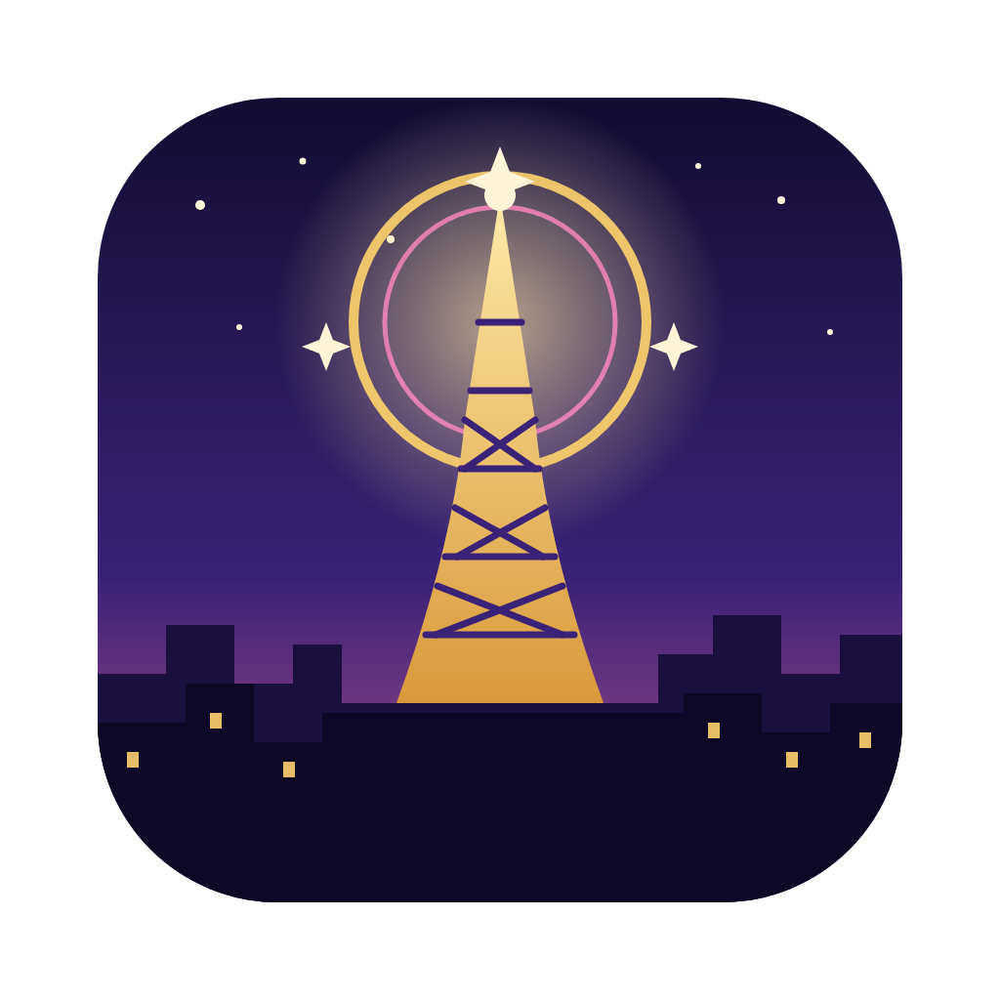

<p align="center">
  
</p>

<h1 align="center">MonZaMac</h1>

<p align="center">
  <strong>Pokémon Legends: Z-A, natively on your Mac</strong><br>
  Apple Silicon &middot; Metal &middot; no emulator
</p>

<p align="center">
  <a href="https://github.com/lucabravi/MonZaMac/releases/latest"></a>
  
  <a href="LICENSE"></a>
</p>

<p align="center">
  <a href="#download-and-play">Download</a> &middot;
  <a href="#status">Status</a> &middot;
  <a href="#building-from-source">Build</a> &middot;
  <a href="CHANGELOG.md">Changelog</a> &middot;
  <a href="https://github.com/lucabravi/MonZaMac/issues">Issues</a>
</p>

---

A native macOS port of **Pokémon Legends: Z-A** (Nintendo Switch, v2.0.2 + the Mega Dimension DLC) built by **static
recompilation**: the game's ARM64 code is translated ahead of time into C and compiled for the Mac, and the Switch's
operating system and GPU (NVN) are reimplemented in the runtime. No emulator runs at play time.

- A Metal renderer with internal resolutions from 25% up to 4x (1080p), SMAA and MetalFX upscaling, and a dynamic
  resolution that follows your GPU
- 30 fps, 60 fps, or 60 fps with steady speed; docked or handheld mode
- Keyboard and controller, the game's own menus and your saves
- A guided setup: point the app at your own game files and it prepares everything on your Mac

> **You need your own copy of the game.** No game files, code, assets or fonts are included in this repository.

## Download and play

You need a Mac with Apple Silicon (macOS 15 or later) and **your own copy of the game** (see above).

1. Download `MonZaMac-<version>-macOS.dmg` from the [latest release](https://github.com/lucabravi/MonZaMac/releases/latest).
2. Open it and drag **MonZaMac** onto **Applications**.
3. Open MonZaMac. The app is not notarized by Apple, so the first time macOS may refuse: right-click the app, choose
   **Open**, then **Open** again.
4. On the start screen choose **SET UP GAME FILES** and confirm that you own an original copy. Select your base game
   (**NSP or XCI**), the **v2.0.2 update (NSP)** and your **prod.keys**. The app checks them, applies the update and
   builds the game on your Mac: it takes a while and needs about 25 GB of free space. Nothing is uploaded.
5. When it is done, press **PLAY**. Pick which save to use on the screen that follows (or start a new one); your saves and settings are kept in `~/Library/Application Support/com.monzamac.app`, and stay
   there when you update the app.

In the game: **F1** opens the menu (video, audio, controls), **F3** shows the frame rate and the render resolution.
Keyboard: WASD move, arrows d-pad, Enter = A, Backspace = B, K = talk, Q / E = L / R; a controller works too.
The first start after an update recompiles some shaders and may stutter for a moment.

The details of the setup are in [First-run setup](#first-run-setup-in-the-packaged-app) below. Building the app from
source is for developers: see [Building from source](#building-from-source).

## Status

**Playable.** The game runs from the intro through the first part of the story, with battles, menus and saves, and
the maintainer has played it that far without problems. It is still a work in progress: later areas and other Macs
have had less testing, so please report what you find.

Looking for the Windows version? It's available at **[PokeZ-ARecomp](https://github.com/Hexveil404/PokeZ-ARecomp)** by
**Hexveil404**.

Working:
- Rendering on Metal: environment, walls, characters (GPU skinning through transform feedback), lighting, GPU-driven
  culling (indirect draws), text, dialogue and UI
- Audio, the game's menus, saves
- Controller and keyboard input

Known issues:
- Characters (NPCs) can pop in and out while walking, mostly at Lumiose station.

Bugs and questions: [GitHub issues](https://github.com/lucabravi/MonZaMac/issues), see [CONTRIBUTING.md](CONTRIBUTING.md).

## First-run setup in the packaged app

The complete app bundle includes its extraction tools, game-code generator and compiler. No Homebrew, Python or
compiler installation is needed by the player. Open **SET UP GAME FILES**, confirm that you own an original copy and have
permission to use the selected files, then choose your base-game **NSP/XCI**, the **v2.0.2 update NSP** and your
**prod.keys**. Setup checks the files and free space, applies the update and builds the game locally. Allow at least
25 GB of free space; the exact requirement can be higher. Compressed NSZ/XCZ packages are not supported; unpack
ZIP/7z archives before selecting the NSP/XCI inside them.

Keys are read locally from the selected file, not copied into app storage or uploaded. Your source dumps are left
untouched. Files are prepared in scratch storage and installed only when all steps succeed; an existing installation
must be removed with **Delete game files** before importing a new copy. Saves and settings are kept. You can also
select **Extracted folder** to import your own `exefs`/`romfs` folders as before.

The ownership declaration records the user's confirmation for setup; it does not replace applicable law or grant
rights to Nintendo's content. Building the app from source still needs the developer tools in [Building from source](#building-from-source).

## Building from source

### Build and run

Requirements: macOS on Apple Silicon, Xcode command line tools, GNU Make 4 (`brew install make`, run as `gmake`: the
macOS `make` is too old), SDL3 and FFmpeg (Homebrew).

1. Install the tools: `brew install make python@3.12 sdl3 ffmpeg` (GNU Make 4 runs as `gmake`).
2. Set up the recompiler (Python 3.12):
   `python3.12 -m venv tools/venv && tools/venv/bin/pip install capstone==5.0.9 unicorn==2.1.4 lz4==4.4.5`
3. Get your game files into `extracted/`. Either extract them from your own dumps with the bundled helper, or place
   them yourself (see below).
4. Recompile the game code from your files: `gmake B=build/za202 GEN=generated-202 gen` (a minute or two).
5. Build: `gmake B=build/za202 GEN=generated-202 -j8` (compiles the generated code and the runtime; the first build
   takes a while).
6. Run: `./build/za202/monzamac extracted --play`. The log goes to the terminal; redirect it to a file to keep it.

### Packaging the app and the dmg

`gmake deps` (once: SDL3, FFmpeg and Python built from pinned sources for macOS 15) then `gmake dmg` build
`build/MonZaMac.app` and `build/dist/MonZaMac-<version>-macOS.dmg`, the file the releases carry. The version comes from
`LARECOMP_VERSION` in `runtime/ui/launcher.mm`; the update check on the start screen reads the GitHub **releases**, not
the tags, so a release needs its dmg attached. The app holds no game files or game code.

### Extracting your game files from a dump

The game is v2.0.2 (+ the Mega Dimension DLC). You need, all from your own Switch and copy of the game:

- your `prod.keys` (dump them with Lockpick_RCM), saved as `.keys/prod.keys` (never committed)
- the base game `.nsp` and the **v2.0.2 update `.nsp`** (the base alone is v1.0.0 and won't work)

```sh
tools/build_nstool.sh                                   # once: builds nstool (jakcron/nstool, MIT) into tools/nstool/
tools/extract_game.sh base.nsp update.nsp               # -> extracted/exefs, extracted/romfs, extracted/romfs.bin
```

`extract_game.sh` unpacks both NSPs, applies the update on top of the base, writes `extracted/exefs/` (`main`,
`main.npdm`, `rtld`, `sdk`) and `extracted/romfs/`, and packs `extracted/romfs.bin`. It needs roughly 25 GB of free disk while it runs
and refuses to overwrite an existing `extracted/`. Already have the files extracted another way? Put them in
`extracted/exefs/` and `extracted/romfs/` (+ `romfs.bin`, which the start screen can also build).


## Layout

- `runtime/` - the runtime: kernel, HLE services, loader, UI
- `runtime/nvn/` - the NVN-to-Metal backend: `maxwell/translate.c` (Maxwell shader to MSL), `renderer.m` (command
  executor), `metal.m` (window and presentation)
- `tools/` - the recompiler (`gen.py`, `lifter.py`) and game-specific tooling (`tools/za/`)

Debug aids: `LARECOMP_*` environment variables (see `runtime/nvn/renderer.m`); `touch build/dumpframe` captures a frame.

## Renderer checks

On macOS, `MTL_DEBUG_LAYER=1 gmake B=build/za202 GEN=generated-202 test-metal-renderer` runs offscreen tests against
the real Metal backend without loading game files. Use `CASE=views`, `clears`, `draws`, `streams`, `layers`, `aspects`, `samplers`
or `types` to select a group. Native sampler reduction and LOD-bias cases require macOS 26 and SDK 26; older builds
report those cases as skipped.

A transform-feedback buffer barrier reuses a render pass after GPU skinning. It is on by
default; turn it off in the Developer tab (Cmd+Shift+D, "Keep passes open after skinning", applies at once), or launch with
`LARECOMP_XFB_END_BARRIER=0` (forces the original behavior and overrides the setting; `=1` forces it on). See
[measurements and limitations](docs/performance-xfb.md). The asset-free regression is `CASE=xfb-barrier`.

### Local GPU profiling

`gpupass 30` in `build/dbgcmd` times each render pass of 30 frames with GPU timestamps (no Xcode, no capture): after the
last frame the log lists the 25 slowest passes by their ordinal in the frame, with size, attachments and draws
(`[gpupass] #12 2.31 ms 2880x1620 colors=3 depth=1 draws=412`). The spans of neighbouring passes overlap on the GPU, so
each pass is charged the time between the previous pass's end and its own, so they add up to the frame's GPU span. It waits for the GPU at each frame end: run it on its own,
not together with a benchmark.

In a running development build, write `gpuprofile 30` to `build/dbgcmd` to collect 30 complete presented frames.
The `[gpu-profile]` lines count guest draws, clear requests, compute dispatches, feedback copies, and the reasons
actual render encoders and command buffers ended. Empty close/submit requests do not count. This is off until
requested; it changes no render state and does not wait for the GPU. See [GPU measurements](docs/performance-gpu.md)
for scope, results and limitations.

To capture one complete frame, launch with Metal capture support, then request the capture from another terminal:

```sh
MTL_CAPTURE_ENABLED=1 tools/hang_sample.sh
printf 'gpucapture\n' > build/dbgcmd
```

The command arms at a present boundary and captures the following frame, including uploads, post-processing and
presentation. A `[gpucapture] completed` line gives the unique `.gputrace` path under `build/gputrace/` in the runtime
data directory. Capture drains the queue at its boundaries, so capture-frame FPS is not a benchmark. Renderer
reset cancels a pending or owned capture; another tool's active capture is left alone.

Keep `.gputrace` documents local: they contain game buffers, textures and shaders, and can occupy tens of gigabytes.
Do not commit or upload them, or derived shader sources. Report numeric measurements and descriptions instead.
Xcode replay and **Profile after replay** can consume much more memory than the trace's disk size. Full-game
counter profiling exceeded the available memory on the test Mac; prefer the lightweight histogram and HUD first.
If inspecting a capture, supervise it and use an external process deadline; the one-frame command limits recorded
frames, not Apple's capture finalization or Xcode analysis time.
For live HUD measurements, use a separate launch with `MTL_HUD_ENABLED=1` and, optionally,
`MTL_HUD_ENCODER_TIMING_ENABLED=1`; use a HUD-free process for capture. A combined HUD/capture run failed inside
Apple's capture writer; a later HUD-free capture in a different scene completed, so the cause is not established.

For a running development build, `trace 2` in `build/dbgcmd` logs draw and compute metadata for two presents
without dumping textures. The window is capped at 120 presents; draw records include the frame and indirect-buffer offset.
The offset describes GPU-backed indirect arguments; CPU-decoded indirect draws share the direct-draw sentinel. The same
window also logs one `[cs-out]` line per compute dispatch (hashes of its storage and uniform buffers, its textures);
`tools/cs_diff.py a.log b.log` compares two captures of the same still scene (for example at 1x and 1.5x) and lists the
dispatches whose output differs, and with `LARECOMP_CS_DUMP=1` `tools/cs_dump_diff.py play.log build/csdump` shows which
words changed. Each traced dispatch is waited for, so the game runs slowly while a window is open.

## Credits and license

MonZaMac is a fork of **[PokeZ-ARecomp](https://github.com/Hexveil404/PokeZ-ARecomp)** (branch `pokemon-za`) by
**Hexveil404**, the Pokémon Legends: Z-A port of **[LAS Recomp](https://github.com/peiikai/LASRecomp)** by **Peiikai**,
whose recompiler, runtime and NVN/Maxwell shader work it builds on (made for *The Legend of Zelda: Link's Awakening*).
Contributors and third-party components are listed in [CREDITS.md](CREDITS.md).

The code is under the [MIT License](LICENSE) (LAS Recomp © Peiikai; the Z-A port and MonZaMac's additions under the same license). This is a fan
project, not affiliated with, endorsed by or sponsored by Nintendo, Game Freak or The Pokémon Company.
