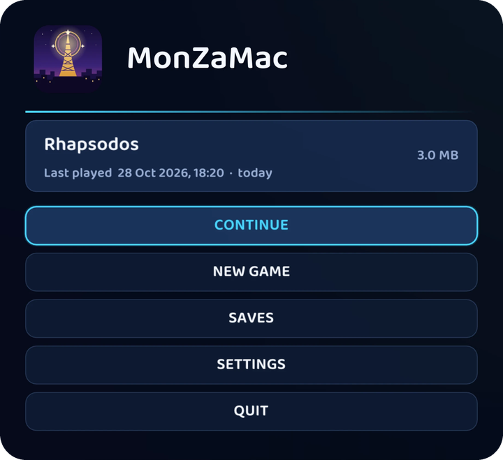

  

<h1 align="center">MonZaMac</h1>

  <strong>Pokémon Legends: Z-A, natively on your Mac</strong> 
  Apple Silicon &middot; Metal &middot; no emulator

  
  
  

  <a href="#download-and-play">Download</a> &middot;
  <a href="#status">Status</a> &middot;
  <a href="#building-from-source">Build</a> &middot;
  <a href="#get-involved">Contribute</a> &middot;
  <a href="CHANGELOG.md">Changelog</a> &middot;
  <a href="https://github.com/lucabravi/MonZaMac/issues">Issues</a> &middot;
  <a href="https://github.com/Hexveil404/PokeZ-ARecomp">PC port (ZA Recomp)</a>

---

  

Play **Pokémon Legends: Z-A on Apple Silicon**, with Metal graphics, higher internal resolutions, keyboard or
controller input, and a guided setup that prepares your own game files on your Mac.

**Fully open source, under the MIT license, and open to contributions.** Help us improve performance, test on more
Macs, fix bugs or make the documentation better. You do not have to be a developer to [get involved](#get-involved).

- **Sharper graphics:** internal resolution from 25% to 4× the game's native image. In docked mode, 1× is 1080p,
  2× is 4K and 4× is 8K at 16:9. Match display and GPU-driven dynamic resolution are available too.
- **Smooth presentation:** 30 or 60 fps modes, SMAA anti-aliasing, MetalFX upscaling and anisotropic filtering.
  Actual performance depends on your Mac, settings and scene; see [Status](#status) for a measured example.
- **Your controls and saves:** remappable keyboard/controller input, docked or handheld mode, and multiple named
  save slots managed from the start screen.
- **A Mac app you can set up yourself:** download the app, select your game files and let the guided setup build
  everything locally. No development tools need to be installed to use the release app.

MonZaMac uses **static recompilation**: the game's ARM64 code is translated ahead of time into C and compiled for
macOS. Its runtime reimplements the Switch operating system services and NVN GPU interface on Metal. No emulator
runs at play time. The supported game version is **v2.0.2 with the Mega Dimension DLC**.

> **Bring your own game.** You need an original copy and game files/keys you are entitled to use. No Nintendo game
> files, code, assets, shaders, keys or fonts are distributed with this project. The open-source license covers
> the project software, not the game or its content.

## Download and play

You need a Mac with Apple Silicon (macOS 15 or later) and **your own copy of the game** (see above).

1. Download `MonZaMac-<version>-macOS.dmg` from the [latest release](https://github.com/lucabravi/MonZaMac/releases/latest).
2. Open it and drag **MonZaMac** onto **Applications**.
3. Open MonZaMac. The app is not notarized by Apple. If macOS blocks it, use **System Settings > Privacy & Security >
   Open Anyway** after attempting to open it, then confirm the prompt.
4. On the start screen choose **SET UP GAME FILES** and confirm that you own an original copy. Select your base game
   (**NSP or XCI**), the **v2.0.2 update (NSP)** and your **prod.keys**. The app checks them, applies the update and
   builds the game on your Mac. Allow at least **27 GB of free space**; larger packages may need more, and setup
   checks the requirement before proceeding. The first build takes a while. No game files or keys are uploaded.
5. When it is done, press **CONTINUE** (your most recent save) or **NEW GAME**. Your saves and settings are kept in
   `~/Library/Application Support/com.monzamac.app`, and stay there when you update the app.

**Saves.** The start screen shows the save you played last. **SAVES** lists them all: pick one, start a new one, copy
(a handy backup before trying something), rename, delete, **export** one as a .zip, or **import** a .zip or a folder
with a Z-A save (a JKSV backup, a copy from a console) as a new save. In the game, **F1 > Saves** shows the save you are
playing and the others, and can switch to another one. A save you already had is the first one in the list, called
"Main save" until you rename it.

A new install starts with fullscreen, a dynamic-resolution preset capped at 1080p, 60 fps, SMAA, the original 16:9
picture and anisotropic filtering. **1080p is the initial preset, not the maximum supported resolution.** Choose
higher internal resolutions or Match display in **SETTINGS**, available before and during play.

In the game: **F1** opens the menu (video, audio, controls), **F3** shows the frame rate and the render resolution.
Default gameplay controls: WASD move, arrows d-pad, K / J = A / B, Q / E = L / R, Enter / Backspace = Plus / Minus;
the numeric keypad controls the camera. Launcher/menu navigation uses Enter to confirm and Esc to go back.
Bindings can be changed in **SETTINGS > Controls**.

Shaders and pipelines compile as needed. A new scene or an update can cause brief first-use stutter; subsequent
visits benefit from the local cache. The **Shaders** tab of the menu can prepare the ones a catalog knows before the
game starts (**Prepare known shaders**), saves the ones the game had to build as hashes and numbers (**Collect new
shader recipes**; nothing is uploaded) so you can share them by hand with **Export shader recipes** and the
**Contribute recipes on GitHub** form, and fetches the official catalog only when you press **Update shader catalog**.
No catalog is published yet.

Building from source and the developer tools are in [docs/development.md](docs/development.md).

## Status

**Playable.** The game runs from the intro through the first part of the story, with battles, menus and saves, and
the maintainer has played it that far without problems. It is still a work in progress: later areas and other Macs
have had less testing, so please report what you find.

On an Apple M5 at 2880x1620 (1.5x, SMAA and anisotropic filtering on) the open world runs at about 60 fps, with small dips
in busy animated scenes.

Looking for the Windows version? It's available at **[PokeZ-ARecomp](https://github.com/Hexveil404/PokeZ-ARecomp)** by
**Hexveil404**.

Working:

- Rendering on Metal: environment, walls, characters (GPU skinning through transform feedback), lighting, GPU-driven
  culling (indirect draws), text, dialogue and UI
- Audio, the game's menus, saves
- Controller and keyboard input

**Known limitations:** brief first-use shader-compilation stutter can occur. No persistent visual defects are
currently known from the maintainer’s testing; later areas and other Mac configurations still need more coverage.

Bugs and questions: [GitHub issues](https://github.com/lucabravi/MonZaMac/issues), see [CONTRIBUTING.md](CONTRIBUTING.md).

## Building from source

For developers: the build steps, game-file extraction, packaging the app and the developer tools are in
[docs/development.md](docs/development.md).

## Get involved

**MonZaMac is an open-source project, and help is welcome.** Small fixes and careful testing matter just as much
as large changes.

- **Play and report:** tell us your chip, macOS version, settings and how to reproduce a problem in
  [GitHub Issues](https://github.com/lucabravi/MonZaMac/issues).
- **Test on your Mac:** performance and compatibility reports from different Apple Silicon models help us find
  improvements that benefit more players.
- **Contribute:** renderer/runtime fixes, performance work, documentation and usability improvements are welcome.
  Read [CONTRIBUTING.md](CONTRIBUTING.md) and the [development guide](docs/development.md), then open an issue or PR.

Keep contributions free of game dumps, keys, extracted assets and generated game code. Share your findings and
changes to the project software; the game files stay on your machine.

## Credits and license

MonZaMac is a fork of **[PokeZ-ARecomp](https://github.com/Hexveil404/PokeZ-ARecomp)** (branch `pokemon-za`) by
**Hexveil404**, the Pokémon Legends: Z-A port of **[LAS Recomp](https://github.com/peiikai/LASRecomp)** by **Peiikai**,
whose recompiler, runtime and NVN/Maxwell shader work it builds on (made for *The Legend of Zelda: Link's Awakening*).
Contributors and third-party components are listed in [CREDITS.md](CREDITS.md).

MonZaMac’s project code is under the [MIT License](LICENSE); third-party components retain their respective
licenses. Nintendo’s game and other protected content are not covered by that license. This is an independent fan
project, not affiliated with, endorsed by or sponsored by Nintendo, GAME FREAK, Creatures Inc. or The Pokémon Company.
Pokémon and related trademarks belong to their respective owners.
